# 📊 3.2. SƠ ĐỒ PHÂN CẤP CHỨC NĂNG (BFD – BUSINESS FUNCTION DIAGRAM)
## Hệ Thống Sàng Lọc & Đánh Giá CV Bằng Trí Tuệ Nhân Tạo

---

### 1. Sơ đồ khối Mermaid phân cấp chức năng (BFD Diagram)

```mermaid
flowchart TD
    ROOT["PHÂN TÍCH THIẾT KẾ HỆ THỐNG<br/><b>SÀNG LỌC & ĐÁNH GIÁ CV BẰNG TRÍ TUỆ NHÂN TẠO</b>"]

    %% 6 Phân hệ chính (Level 1)
    M1["1. Quản lý tài khoản"]
    M2["2. Quản lý tin tuyển dụng"]
    M3["3. Phân tích CV bằng AI"]
    M4["4. Cổng ứng viên"]
    M5["5. Cổng nhà tuyển dụng"]
    M6["6. Quản trị hệ thống"]

    ROOT --> M1
    ROOT --> M2
    ROOT --> M3
    ROOT --> M4
    ROOT --> M5
    ROOT --> M6

    %% Phân hệ 1
    M1 --> F11["1.1 Đăng ký tài khoản"]
    M1 --> F12["1.2 Đăng nhập / Đăng xuất"]
    M1 --> F13["1.3 Chỉnh sửa hồ sơ cá nhân"]
    M1 --> F14["1.4 Phân quyền RBAC 3 cấp"]

    %% Phân hệ 2
    M2 --> F21["2.1 Tạo tin tuyển dụng (JD)"]
    M2 --> F22["2.2 Chỉnh sửa / Xóa tin đăng"]
    M2 --> F23["2.3 Cấu hình bộ trọng số yêu cầu"]
    M2 --> F24["2.4 Kích hoạt / Ẩn tin đăng"]

    %% Phân hệ 3 (Lõi AI)
    M3 --> F31["3.1 Trích xuất văn bản CV (Parser + OCR)"]
    M3 --> F32["3.2 Nhận diện kỹ năng IT (80+ Taxonomy)"]
    M3 --> F33["3.3 Tính điểm S-BERT Semantic Matching"]
    M3 --> F34["3.4 Chấm điểm 4 quy tắc S_total"]
    M3 --> F35["3.5 Phát hiện Keyword Stuffing"]

    %% Phân hệ 4
    M4 --> F41["4.1 Xem danh sách việc làm"]
    M4 --> F42["4.2 Nộp CV ứng tuyển"]
    M4 --> F43["4.3 Xem kết quả AI & AI Coach"]
    M4 --> F44["4.4 Theo dõi hồ sơ đã nộp"]

    %% Phân hệ 5
    M5 --> F51["5.1 HR Dashboard (Thống kê)"]
    M5 --> F52["5.2 Bảng xếp hạng ứng viên AI"]
    M5 --> F53["5.3 Sàng lọc đa tiêu chí"]
    M5 --> F54["5.4 Tải CV hàng loạt"]
    M5 --> F55["5.5 Xuất báo cáo Excel / CSV"]

    %% Phân hệ 6
    M6 --> F61["6.1 Quản lý người dùng"]
    M6 --> F62["6.2 Django Admin Portal"]
    M6 --> F63["6.3 Giám sát hàng đợi Celery"]
    M6 --> F64["6.4 Cấu hình hệ thống"]

    %% Styling
    classDef rootStyle fill:#312e81,stroke:#6366f1,stroke-width:2px,color:#ffffff;
    classDef m1Style fill:#1e293b,stroke:#475569,stroke-width:1.5px,color:#ffffff;
    classDef m2Style fill:#1d4ed8,stroke:#3b82f6,stroke-width:1.5px,color:#ffffff;
    classDef m3Style fill:#6b21a8,stroke:#a855f7,stroke-width:2px,color:#ffffff;
    classDef m4Style fill:#047857,stroke:#10b981,stroke-width:1.5px,color:#ffffff;
    classDef m5Style fill:#b45309,stroke:#f59e0b,stroke-width:1.5px,color:#ffffff;
    classDef m6Style fill:#be123c,stroke:#f43f5e,stroke-width:1.5px,color:#ffffff;
    classDef leafStyle fill:#ffffff,stroke:#cbd5e1,stroke-width:1px,color:#0f172a;

    class ROOT rootStyle;
    class M1 m1Style;
    class M2 m2Style;
    class M3 m3Style;
    class M4 m4Style;
    class M5 m5Style;
    class M6 m6Style;
    class F11,F12,F13,F14,F21,F22,F23,F24,F31,F32,F33,F34,F35,F41,F42,F43,F44,F51,F52,F53,F54,F55,F61,F62,F63,F64 leafStyle;
```

---

### 2. Danh mục phân rã 26 chức năng chi tiết (Bảo toàn 100%)

#### 1. Quản lý tài khoản
- **1.1 Đăng ký tài khoản:** Cho phép Ứng viên (Candidate) và Nhà tuyển dụng (HR Recruiter) tạo tài khoản độc lập.
- **1.2 Đăng nhập / Đăng xuất:** Xác thực người dùng an toàn với mã hóa mật khẩu PBKDF2 của Django.
- **1.3 Chỉnh sửa hồ sơ cá nhân:** Cập nhật thông tin họ tên, số điện thoại, tên công ty và avatar.
- **1.4 Phân quyền RBAC 3 cấp:** Kiểm soát truy cập chặt chẽ qua Decorator & Middleware theo 3 vai trò: `Candidate`, `HR`, `Admin`.

#### 2. Quản lý tin tuyển dụng
- **2.1 Tạo tin tuyển dụng (JD):** Soạn thảo bài đăng tuyển dụng, thiết lập danh sách kỹ năng trọng tâm dạng tag, số năm kinh nghiệm tối thiểu, mức lương và địa điểm.
- **2.2 Chỉnh sửa / Xóa tin đăng:** Cho phép cập nhật hoặc loại bỏ tin tuyển dụng thuộc quyền sở hữu của công ty.
- **2.3 Cấu hình bộ trọng số yêu cầu:** Tùy biến tỷ trọng phần trăm chấm điểm 4 trụ cột phù hợp với từng vị trí công việc.
- **2.4 Kích hoạt / Ẩn tin đăng:** Đóng hoặc mở lại các đợt tiếp nhận hồ sơ tuyển dụng.

#### 3. Phân tích CV bằng AI (Lõi Trí Tuệ Nhân Tạo)
- **3.1 Trích xuất văn bản CV (Parser + OCR):** Bóc tách chữ từ tệp PDF, DOCX và tự động kích hoạt OCR Fallback (Tesseract / EasyOCR) nếu phát hiện file scan dạng ảnh.
- **3.2 Nhận diện kỹ năng IT (80+ Taxonomy):** Quét và chuẩn hóa danh mục kỹ năng Công nghệ Thông tin từ bộ từ điển chuyên sâu, xử lý các từ khóa bẫy cú pháp (C++, C#, .NET).
- **3.3 Tính điểm S-BERT Semantic Matching:** Đo khoảng cách ngữ nghĩa ngữ cảnh giữa JD và CV qua Cosine Similarity bằng mô hình `paraphrase-multilingual-MiniLM-L12-v2`.
- **3.4 Chấm điểm 4 quy tắc S_total:** Tính toán điểm tổng hợp theo công thức đa tiêu chí: 35% Kỹ năng + 25% Ngữ nghĩa + 25% Kinh nghiệm + 15% Học vấn.
- **3.5 Phát hiện Keyword Stuffing:** Nhận diện hành vi gian lận nhồi nhét từ khóa ẩn trong CV, tự động áp dụng hệ số phạt điểm và cảnh báo HR.

#### 4. Cổng ứng viên
- **4.1 Xem danh sách việc làm:** Khám phá các vị trí tuyển dụng công khai với bộ lọc từ khóa, kỹ năng và kinh nghiệm.
- **4.2 Nộp CV ứng tuyển:** Kéo thả tệp CV để ứng tuyển trực tiếp vào vị trí mong muốn.
- **4.3 Xem kết quả AI & AI Coach:** Xem phản hồi phân tích XAI trực quan (kỹ năng đã khớp màu xanh, kỹ năng còn thiếu màu đỏ) và lời khuyên lộ trình phát triển.
- **4.4 Theo dõi hồ sơ đã nộp:** Quản lý danh sách các công việc đã ứng tuyển và tình trạng xét duyệt từ nhà tuyển dụng.

#### 5. Cổng nhà tuyển dụng
- **5.1 HR Dashboard (Thống kê):** Bảng số liệu tổng quan trực quan về số tin tuyển dụng đang mở, tổng CV tiếp nhận và tỷ lệ phân loại hồ sơ.
- **5.2 Bảng xếp hạng ứng viên AI:** Sắp xếp ứng viên tự động theo điểm số phù hợp giảm dần, vinh danh huy chương TOP 1, TOP 2, TOP 3.
- **5.3 Sàng lọc đa tiêu chí:** Lọc hồ sơ theo thang điểm, phân loại trạng thái hoặc dùng tính năng Multi-Job Batch Screening để AI tìm vị trí phù hợp nhất.
- **5.4 Tải CV hàng loạt:** Cho phép tải lên đồng thời nhiều hồ sơ để AI xử lý tự động trong một lần thao tác.
- **5.5 Xuất báo cáo Excel / CSV:** Xuất bảng tổng hợp kết quả ứng viên dạng file Excel (.xlsx) định dạng chuyên nghiệp hoặc CSV encoding UTF-8 BOM.

#### 6. Quản trị hệ thống
- **6.1 Quản lý người dùng:** Quản trị viên kích hoạt, tạm khóa hoặc phân cấp vai trò người dùng trong hệ thống.
- **6.2 Django Admin Portal:** Giao diện quản trị cơ sở dữ liệu chuyên sâu tại đường dẫn `/admin/`.
- **6.3 Giám sát hàng đợi Celery:** Kiểm tra trạng thái worker bất đồng bộ và kiểm soát hàng đợi Redis.
- **6.4 Cấu hình hệ thống:** Quản lý các tham số môi trường, kết nối Database, dịch vụ gửi Email thông báo và động cơ AI.
