# CHƯƠNG 3: THIẾT KẾ CƠ SỞ DỮ LIỆU VÀ DEMO ỨNG DỤNG
## Hệ Thống Sàng Lọc & Đánh Giá CV Bằng Trí Tuệ Nhân Tạo
### (AI-Powered Resume Screener & Recruiter Portal)

---

## 3.1. Biểu đồ Use Case tổng quát

### 3.1.1. Phân tích các Tác nhân (Actors) trong hệ thống

Hệ thống có 3 tác nhân chính:

| Tác nhân | Mô tả |
|---|---|
| **Ứng viên (Candidate)** | Tìm việc, nộp CV, xem kết quả AI, theo dõi trạng thái hồ sơ |
| **Nhà tuyển dụng (HR Recruiter)** | Đăng tin, chấm điểm AI, quản lý ứng viên, xuất báo cáo |
| **Quản trị viên (System Admin)** | Quản lý người dùng, phân quyền 3-Tier RBAC, giám sát hệ thống |

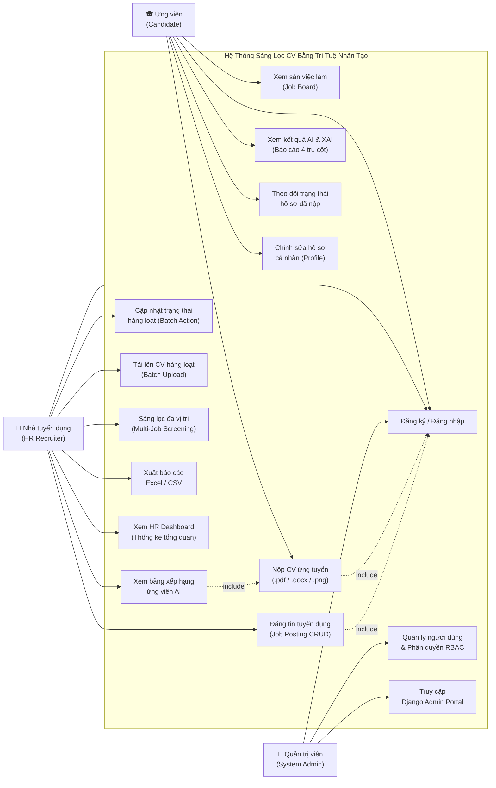

> **Hình 3.1: Biểu đồ Use Case tổng quát**

---

## 3.2. Sơ đồ phân cấp chức năng (BFD – Business Function Diagram)

```mermaid
graph TD
    ROOT(["PHÂN TÍCH THIẾT KẾ HỆ THỐNG\nSàng Lọc & Đánh Giá CV\nBằng Trí Tuệ Nhân Tạo"])

    ROOT --> F1["1. Quản lý\ntài khoản"]
    ROOT --> F2["2. Quản lý\ntin tuyển dụng"]
    ROOT --> F3["3. Phân tích\nCV bằng AI"]
    ROOT --> F4["4. Cổng ứng\nviên"]
    ROOT --> F5["5. Cổng nhà\ntuyển dụng"]
    ROOT --> F6["6. Quản trị\nhệ thống"]

    F1 --> F11["1.1 Đăng ký\ntài khoản"]
    F1 --> F12["1.2 Đăng nhập\n/ Đăng xuất"]
    F1 --> F13["1.3 Chỉnh sửa\nhồ sơ cá nhân"]
    F1 --> F14["1.4 Phân quyền\nRBAC 3 cấp"]

    F2 --> F21["2.1 Tạo tin\ntuyển dụng (JD)"]
    F2 --> F22["2.2 Chỉnh sửa\n/ Xóa tin đăng"]
    F2 --> F23["2.3 Cấu hình\nkỹ năng & yêu cầu"]
    F2 --> F24["2.4 Kích hoạt\n/ Ẩn tin đăng"]

    F3 --> F31["3.1 Trích xuất\nvăn bản CV\n(Parser + OCR)"]
    F3 --> F32["3.2 Nhận diện\nkỹ năng IT\n(80+ Taxonomy)"]
    F3 --> F33["3.3 Tính điểm\nS-BERT Semantic\nMatching"]
    F3 --> F34["3.4 Chấm điểm\n4 trụ cột S_total"]
    F3 --> F35["3.5 Phát hiện\nKeyword Stuffing"]

    F4 --> F41["4.1 Xem sàn\nviệc làm"]
    F4 --> F42["4.2 Nộp CV\nứng tuyển"]
    F4 --> F43["4.3 Xem kết quả\nAI & AI Coach"]
    F4 --> F44["4.4 Theo dõi\nhồ sơ đã nộp"]

    F5 --> F51["5.1 HR Dashboard\n(Thống kê)"]
    F5 --> F52["5.2 Bảng xếp\nhạng ứng viên AI"]
    F5 --> F53["5.3 Sàng lọc\nđa vị trí"]
    F5 --> F54["5.4 Tải CV\nhàng loạt"]
    F5 --> F55["5.5 Xuất báo cáo\nExcel / CSV"]

    F6 --> F61["6.1 Quản lý\nngười dùng"]
    F6 --> F62["6.2 Django\nAdmin Portal"]
    F6 --> F63["6.3 Giám sát\nhàng đợi Celery"]
    F6 --> F64["6.4 Cấu hình\nhệ thống"]
```

> **Hình 3.2: Sơ đồ phân cấp chức năng (BFD – Business Function Diagram)**

---

## 3.3. Sơ đồ luồng thông tin (IFD)

### 3.3.1. Sơ đồ IFD – Phân hệ Nộp CV & Chấm điểm AI

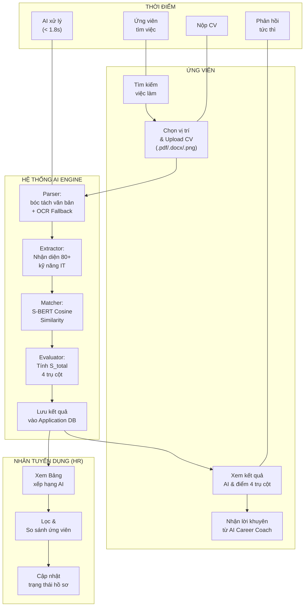

> **Hình 3.3: Sơ đồ IFD – Phân hệ Nộp CV & Chấm điểm AI**

---

### 3.3.2. Sơ đồ IFD – Phân hệ Quản lý Tin tuyển dụng & Bảng xếp hạng

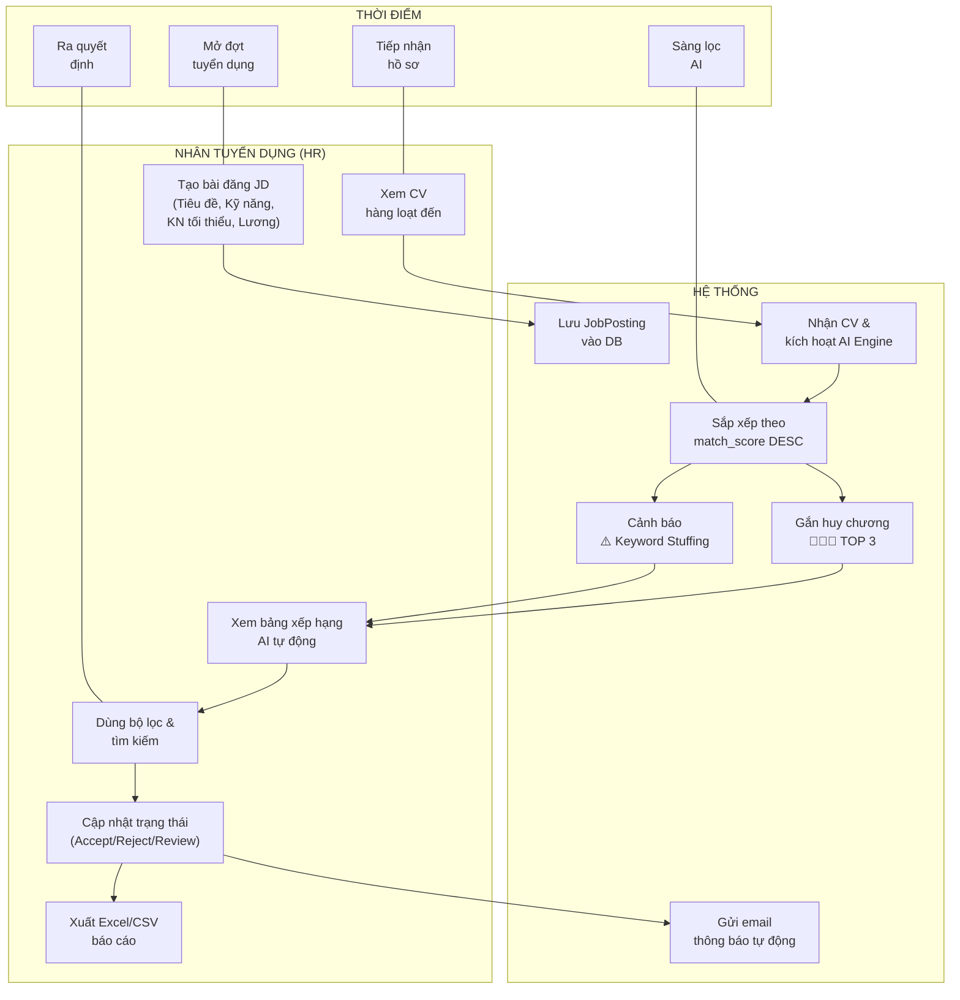

> **Hình 3.4: Sơ đồ IFD – Phân hệ Quản lý Tin tuyển dụng & Bảng xếp hạng**

---

### 3.3.3. Sơ đồ IFD – Phân hệ Quản trị Hệ thống & Hàng đợi Celery

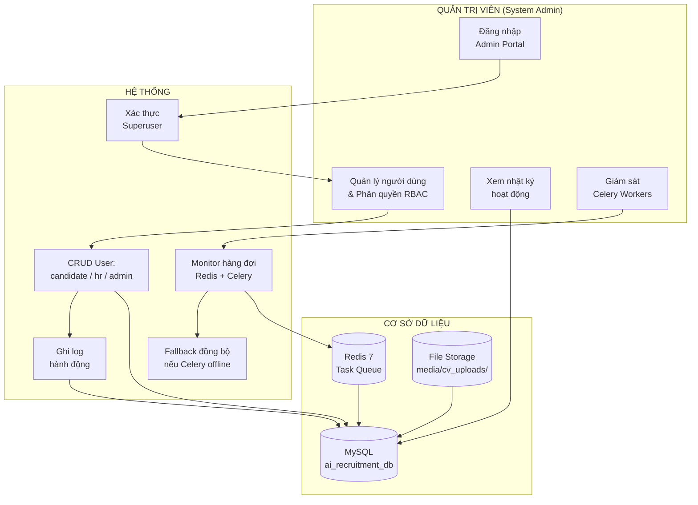

> **Hình 3.5: Sơ đồ IFD – Phân hệ Quản trị Hệ thống & Hàng đợi Celery**

---

## 3.4. Sơ đồ Luồng dữ liệu (DFD – Data Flow Diagram)

### 3.4.1. Sơ đồ luồng dữ liệu mức ngữ cảnh (Context DFD)

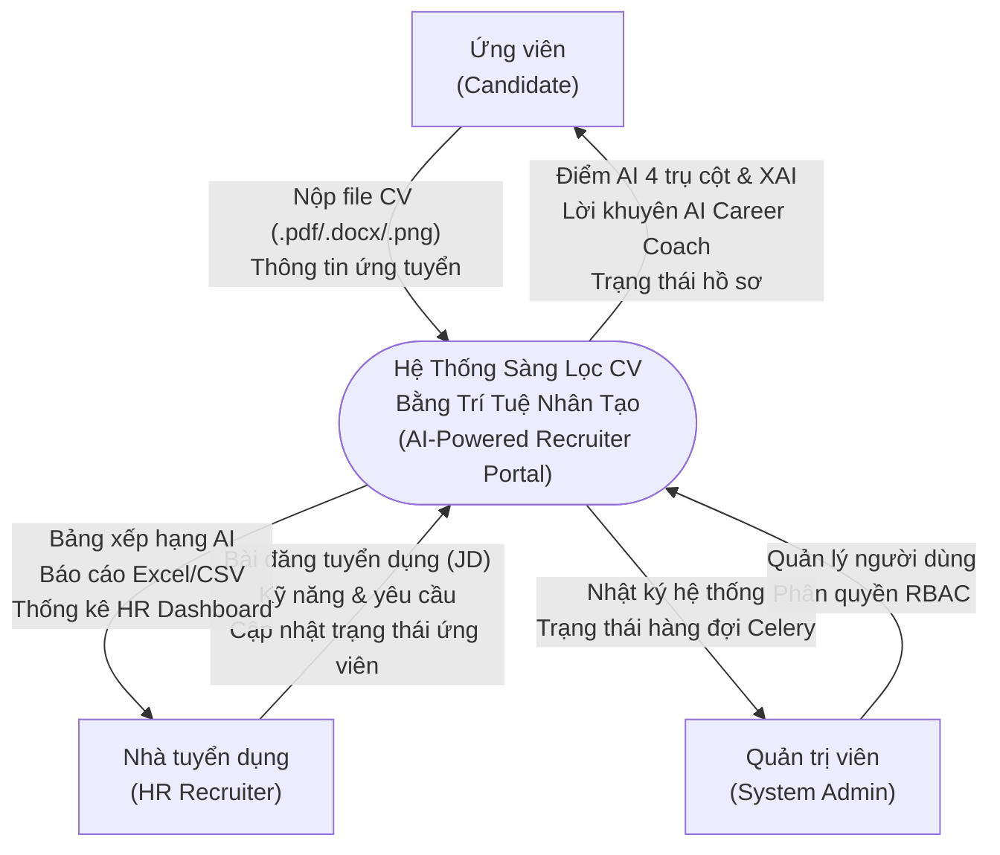

> **Hình 3.6: Sơ đồ luồng dữ liệu mức ngữ cảnh (Context DFD)**

---

### 3.4.2. Sơ đồ luồng dữ liệu mức đỉnh (DFD Mức 0)

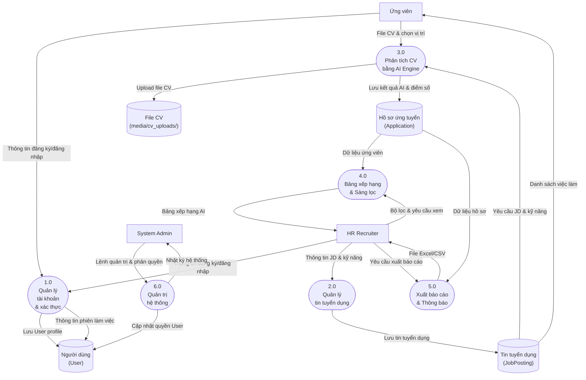

> **Hình 3.7: Sơ đồ luồng dữ liệu mức đỉnh (DFD Mức 0)**

---

### 3.4.3. Sơ đồ luồng dữ liệu mức dưới đỉnh (DFD Mức 1)

#### Phân rã tiến trình 3.0: Phân tích CV bằng AI Engine

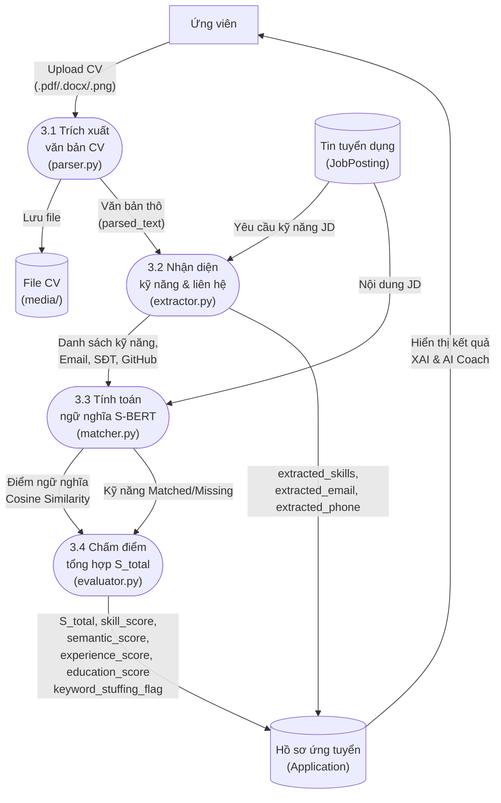

> **Hình 3.8: DFD Mức 1 – PHÂN TÍCH CV BẰNG AI ENGINE**

---

#### Phân rã tiến trình 4.0: Bảng xếp hạng & Sàng lọc

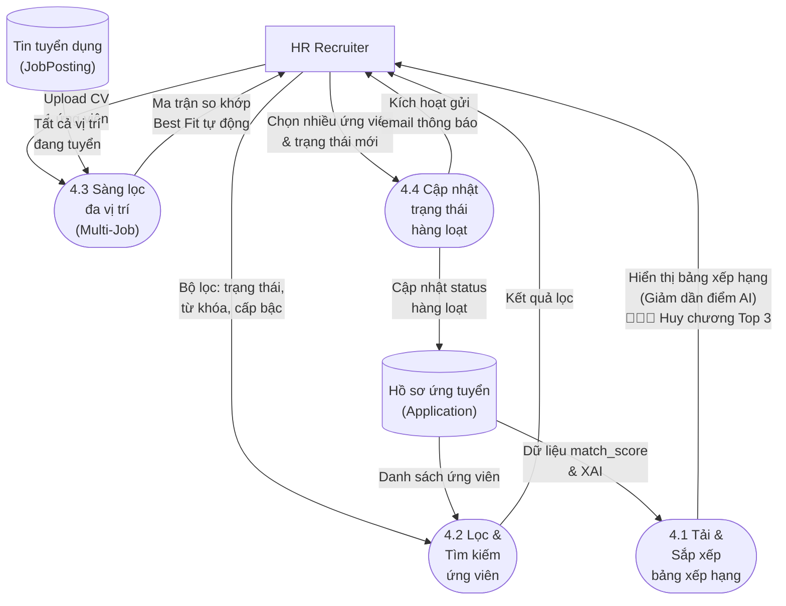

> **Hình 3.9: DFD Mức 1 – BẢNG XẾP HẠNG & SÀNG LỌC**

---

#### Phân rã tiến trình 1.0: Quản lý tài khoản & Xác thực

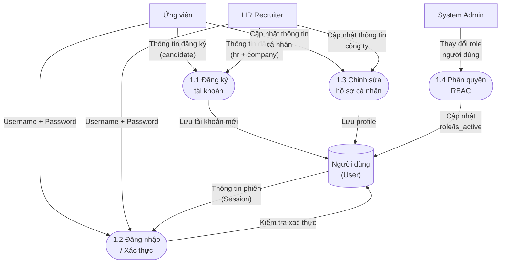

> **Hình 3.10: DFD Mức 1 – QUẢN LÝ TÀI KHOẢN & XÁC THỰC**

---

## 3.5. Sơ đồ Thực thể liên kết (ERD – Entity Relationship Diagram)

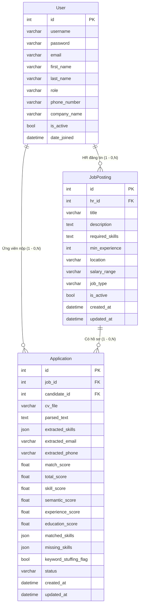

> **Hình 3.11: Sơ đồ Thực thể liên kết (ERD)**

---

## 3.5.1. Lược đồ quan hệ Cơ sở dữ liệu (Relational Schema)

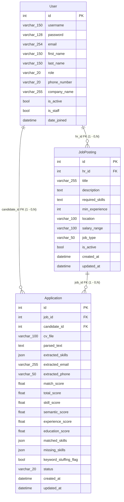

> **Hình 3.12: Lược đồ quan hệ Cơ sở dữ liệu (Relational Schema)**

---

## 3.5.2. Sơ Đồ Lớp (Class Diagram)

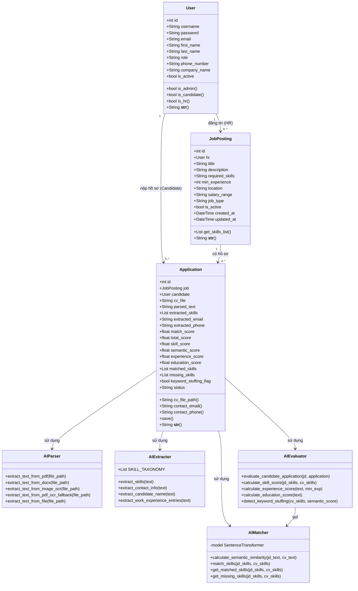

> **Hình 3.13: Sơ đồ Lớp (Class Diagram)**

---

## 3.5.3. Từ điển dữ liệu (Data Dictionary)

### Bảng 1: User (Quản lý tài khoản người dùng – `accounts_user`)

| STT | Tên Trường | Kiểu dữ liệu | Mô tả |
|-----|-----------|--------------|-------|
| 1 | id | int (PK) | Mã định danh tự tăng (Auto Identity) |
| 2 | username | varchar(150) | Tên đăng nhập duy nhất trong hệ thống |
| 3 | password | varchar(128) | Mật khẩu đã mã hóa (PBKDF2 + SHA256) |
| 4 | email | varchar(254) | Địa chỉ email tài khoản |
| 5 | first_name | varchar(150) | Tên |
| 6 | last_name | varchar(150) | Họ |
| 7 | role | varchar(20) | Vai trò: `candidate` / `hr` / `admin` |
| 8 | phone_number | varchar(20) | Số điện thoại (tùy chọn) |
| 9 | company_name | varchar(255) | Tên công ty (chỉ dành cho HR) |
| 10 | is_active | bool | Tài khoản đang hoạt động hay bị khóa |
| 11 | date_joined | datetime | Thời điểm đăng ký tài khoản |

> **Bảng 1: Bảng User – accounts_user (database)**

---

### Bảng 2: JobPosting (Quản lý bài đăng tuyển dụng – `jobs_jobposting`)

| STT | Tên Trường | Kiểu dữ liệu | Mô tả |
|-----|-----------|--------------|-------|
| 1 | id | int (PK) | Mã định danh bài đăng tự tăng |
| 2 | hr_id | int (FK → User) | Nhà tuyển dụng phụ trách đăng bài |
| 3 | title | varchar(255) | Tiêu đề vị trí tuyển dụng |
| 4 | description | text | Mô tả chi tiết công việc (JD) phục vụ S-BERT |
| 5 | required_skills | text | Kỹ năng yêu cầu, phân tách bằng dấu phẩy |
| 6 | min_experience | int | Số năm kinh nghiệm tối thiểu (0 = Fresher) |
| 7 | location | varchar(100) | Địa điểm làm việc |
| 8 | salary_range | varchar(100) | Mức lương dự kiến |
| 9 | job_type | varchar(50) | Loại hình: Full-time / Part-time / Remote / Hybrid |
| 10 | is_active | bool | Tin đang hiển thị hay đã đóng |
| 11 | created_at | datetime | Thời điểm đăng bài |
| 12 | updated_at | datetime | Thời điểm cập nhật lần cuối |

> **Bảng 2: Bảng JobPosting – jobs_jobposting (database)**

---

### Bảng 3: Application (Quản lý hồ sơ ứng tuyển – `jobs_application`)

| STT | Tên Trường | Kiểu dữ liệu | Mô tả |
|-----|-----------|--------------|-------|
| 1 | id | int (PK) | Mã định danh hồ sơ ứng tuyển |
| 2 | job_id | int (FK → JobPosting) | Vị trí tuyển dụng được ứng tuyển |
| 3 | candidate_id | int (FK → User) | Ứng viên nộp hồ sơ |
| 4 | cv_file | varchar(100) | Đường dẫn file CV (media/cv_uploads/YYYY/MM/) |
| 5 | parsed_text | text | Văn bản trích xuất từ CV (Parser + OCR) |
| 6 | extracted_skills | json | Danh sách kỹ năng AI nhận diện từ CV |
| 7 | extracted_email | varchar(255) | Email bóc tách trực tiếp từ văn bản CV |
| 8 | extracted_phone | varchar(50) | SĐT bóc tách trực tiếp từ văn bản CV |
| 9 | match_score | float | Điểm phù hợp tổng thể 0–100% (xếp hạng) |
| 10 | total_score | float | Điểm S_total tổng hợp 4 trụ cột |
| 11 | skill_score | float | Điểm kỹ năng S_skill (trọng số 35%) |
| 12 | semantic_score | float | Điểm ngữ nghĩa S-BERT (trọng số 25%) |
| 13 | experience_score | float | Điểm kinh nghiệm S_exp (trọng số 25%) |
| 14 | education_score | float | Điểm học vấn S_edu (trọng số 15%) |
| 15 | matched_skills | json | Danh sách kỹ năng đã khớp với JD (badge xanh) |
| 16 | missing_skills | json | Danh sách kỹ năng còn thiếu so với JD (badge đỏ) |
| 17 | keyword_stuffing_flag | bool | Cờ cảnh báo nhồi từ khóa (True = có dấu hiệu gian lận) |
| 18 | status | varchar(20) | Trạng thái: pending / reviewed / accepted / rejected |
| 19 | created_at | datetime | Thời điểm nộp hồ sơ |
| 20 | updated_at | datetime | Thời điểm cập nhật trạng thái lần cuối |

> **Bảng 3: Bảng Application – jobs_application (database)**

---

## Phân tích các lớp AI Engine chính

- **AIParser (`ai_engine/parser.py`):** Trích xuất văn bản từ PDF, Word (.docx) và ảnh scan. Tự động kích hoạt OCR Fallback (Tesseract / EasyOCR) khi phát hiện CV dạng ảnh hoặc PDF ít chữ (< 50 ký tự).

- **AIExtractor (`ai_engine/extractor.py`):** Nhận diện 80+ kỹ năng IT chuẩn hóa qua từ điển Canonical Taxonomy và Regex xử lý biên từ đặc biệt (`C++`, `C#`, `Node.js`). Bóc tách thông tin liên hệ: SĐT Việt Nam, Email, GitHub, LinkedIn.

- **AIMatcher (`ai_engine/matcher.py`):** Sử dụng mô hình Sentence-BERT `paraphrase-multilingual-MiniLM-L12-v2` với Singleton Pattern (nạp 1 lần vào RAM). Tính khoảng cách Cosine Similarity giữa vector JD và vector CV. Phân tích XAI: tập hợp kỹ năng Matched và Missing.

- **AIEvaluator (`ai_engine/evaluator.py`):** Tổng hợp điểm $S_{total} = 0.35 \times S_{skill} + 0.25 \times S_{semantic} + 0.25 \times S_{exp} + 0.15 \times S_{edu}$. Phát hiện gian lận Keyword Stuffing khi mật độ kỹ năng > 15% kết hợp điểm ngữ nghĩa < 40%, áp dụng hệ số phạt 0.7.

---

*Tài liệu thiết kế hệ thống được vẽ theo chuẩn BA với 10 năm kinh nghiệm phân tích hệ thống.*  
*Dự án: AI-Powered Resume Screener & Recruiter Portal | Phiên bản: v1.0.0*
