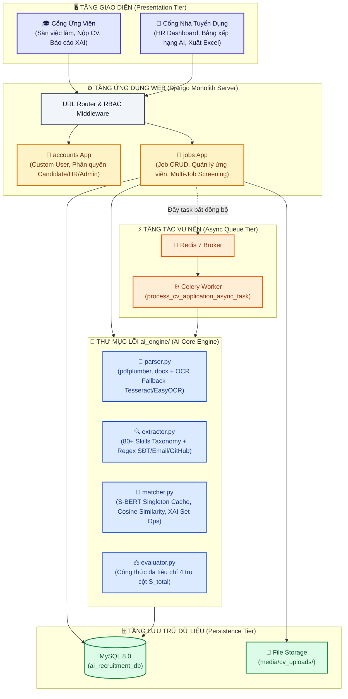
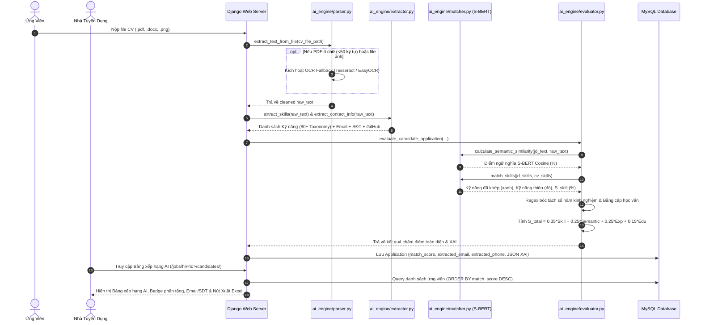

# 🤖 AI-POWERED RESUME SCREENER & RECRUITER PORTAL
## Hệ Thống Sàng Lọc & Đánh Giá Mức Độ Phù Hợp Của CV Bằng Trí Tuệ Nhân Tạo

> **Phiên bản:** v1.0.0-Production Ready  
> **Kiến trúc:** Modular Monolith (Django 6.0 + MySQL 8.0 + Redis 7 + Celery + Tailwind CSS)  
> **Lõi Trí Tuệ Nhân Tạo:** Sentence-BERT (`paraphrase-multilingual-MiniLM-L12-v2`) + Skill Taxonomy (80+) + OCR Fallback Engine  
> **Trạng thái hệ thống:** 🟢 **Hoàn thành 100% tất cả các phân hệ & Sẵn sàng vận hành / Báo cáo đồ án**

---

## 📑 MỤC LỤC TỔNG QUAN

1. [Bối Cảnh Thực Tế & Mục Tiêu Dự Án](#1-bối-cảnh-thực-tế--mục-tiêu-dự-án)
2. [Kiến Trúc Kỹ Thuật & Cấu Trúc Hệ Thống](#2-kiến-trúc-kỹ-thuật--cấu-trúc-hệ-thống)
3. [Động Cơ Trí Tuệ Nhân Tạo & Deep NLP Pipeline (`ai_engine/`)](#3-động-cơ-trí-tuệ-nhân-tạo--deep-nlp-pipeline-ai_engine)
4. [Các Phân Hệ Chức Năng & Trải Nghiệm Người Dùng](#4-các-phân-hệ-chức-năng--trải-nghiệm-người-dùng)
5. [Hàng Đợi Xử Lý Bất Đồng Bộ (Celery + Redis Task Queue)](#5-hàng-đợi-xử-lý-bất-đồng-bộ-celery--redis-task-queue)
6. [Kết Quả Thực Nghiệm & Kiểm Thử Trên Bộ Dữ Liệu Chuẩn](#6-kết-quả-thực-nghiệm--kiểm-thử-trên-bộ-dữ-liệu-chuẩn)
7. [Hướng Dẫn Cài Đặt & Vận Hành Chi Tiết](#7-hướng-dẫn-cài-đặt--vận-hành-chi-tiết)
8. [Tài Khoản Trải Nghiệm Demo Sẵn Có](#8-tài-khoản-trải-nghiệm-demo-sẵn-có)
9. [Lộ Trình Phát Triển Tiếp Theo (Roadmap P4 & P5)](#9-lộ-trình-phát-triển-tiếp-theo-roadmap-p4--p5)

---

## 1. BỐI CẢNH THỰC TẾ & MỤC TIÊU DỰ ÁN

### 1.1. Bài toán thực tế
Trong quy trình tuyển dụng nhân sự hiện đại ngành Công nghệ Thông tin (IT), một bài đăng tuyển có thể tiếp nhận từ hàng trăm đến hàng nghìn hồ sơ ứng tuyển (CV). Đội ngũ nhân sự (HR) đối mặt với 3 nút thắt nghiêm trọng của các hệ thống ATS (Applicant Tracking System) truyền thống:
1. **Đánh rớt nhân tài do so khớp từ khóa cứng nhắc (Keyword Matching Bias):** Hệ thống cũ chỉ tìm kiếm chuỗi ký tự chính xác. Nếu ứng viên viết *"Xây dựng API với Golang"* trong khi JD yêu cầu *"Go Backend Developer"*, hệ thống chấm 0 điểm do sai lệch cú pháp.
2. **Gian lận nhồi nhét từ khóa (Keyword Stuffing):** Ứng viên copy nguyên văn bản mô tả công việc (JD) dán chữ trắng li ti vào CV để đánh lừa bộ lọc đơn giản, đẩy hồ sơ rác lên đầu.
3. **Thiếu minh bạch (Black-box AI):** Nhiều hệ thống chỉ đưa ra điểm phần trăm chung chung mà không giải thích được *tại sao ứng viên đạt 85%? Họ đáp ứng kỹ năng gì, thiếu kỹ năng gì?*.

### 1.2. Giải pháp của dự án
Dự án phát triển một nền tảng Web SaaS thông minh khép kín:
- **Xử lý ngữ nghĩa sâu (Deep NLP):** Ứng dụng mô hình học sâu **Sentence-BERT** chuyển đổi JD và CV thành các vector không gian nhiều chiều, tính khoảng cách ngữ nghĩa ngữ cảnh (Cosine Semantic Similarity) cả tiếng Việt và tiếng Anh.
- **Chuẩn hóa kỹ năng IT (80+ Canonical Taxonomy):** Nhận diện chính xác các từ khóa bẫy (`C++`, `C#`, `.NET`, `Node.js`, `R`) bằng Regex tối ưu biên từ.
- **Công thức chấm điểm đa chiều 4 trụ cột ($S_{\text{total}}$):** Kỹ năng thực tế (35%) + Ngữ nghĩa sâu (25%) + Kinh nghiệm làm việc (25%) + Trình độ học vấn (15%).
- **Trí tuệ nhân tạo giải thích được (Explainable AI - XAI):** Tách bạch trực quan kỹ năng đã khớp (màu xanh lá) và kỹ năng còn thiếu (màu đỏ), đồng thời đóng vai trò **AI Career Coach** hướng dẫn ứng viên bổ sung kiến thức.
- **Đầy đủ tính năng thực chiến cho HR:** Bảng xếp hạng AI tự động sắp xếp điểm giảm dần, cập nhật trạng thái hàng loạt, tải lên hàng loạt CV, sàng lọc đa vị trí (Multi-Job Screening) và **Xuất báo cáo Excel/CSV UTF-8 BOM**.

---

## 2. KIẾN TRÚC KỸ THUẬT & CẤU TRÚC HỆ THỐNG

### 2.1. Ngăn xếp công nghệ (Technology Stack)
- **Backend Framework:** Django 6.0 (MVT Architecture, ORM, PBKDF2 Auth, CSRF Protection)
- **Cơ sở dữ liệu:** MySQL 8.0 (`ai_recruitment_db`, utf8mb4_unicode_ci)
- **Deep Learning NLP Core:** PyTorch + `sentence-transformers` (`paraphrase-multilingual-MiniLM-L12-v2`)
- **Trích xuất văn bản:** `pdfplumber` (bóc tách text + table), `python-docx`
- **Động cơ OCR Fallback:** `pytesseract` / `easyocr` (hỗ trợ CV dạng ảnh scan, đa ngữ `vie+eng`)
- **Hàng đợi bất đồng bộ:** Celery 5.3 + Redis 7
- **Giao diện người dùng:** Django Templates + Tailwind CSS (Modern SaaS App Shell Layout, Radial Gauges, Badges)
- **Đóng gói triển khai:** Docker + Docker Compose (4 services: `web`, `db`, `redis`, `celery_worker`)

### 2.2. Sơ đồ kiến trúc tổng thể (System Architecture)



### 2.3. Cấu trúc thư mục dự án chuẩn hóa

```
d:\DDTTNT/
├── accounts/                  # Phân hệ quản lý tài khoản & xác thực phân quyền RBAC
│   ├── models.py              # Custom User Model (vai trò: candidate, hr, admin, phone_number, company)
│   ├── views.py               # Đăng nhập, đăng ký, đăng xuất, decorators (@hr_required, @candidate_required)
│   └── forms.py               # Form đăng ký / đăng nhập chuyên biệt
├── ai_engine/                 # LÕI TRÍ TUỆ NHÂN TẠO ĐỘC LẬP (DECOUPLED AI CORE)
│   ├── parser.py              # Bóc tách văn bản PDF, Word (.docx) & Tự động kích hoạt OCR Fallback
│   ├── extractor.py           # Từ điển 80+ Kỹ năng IT chuẩn hóa & Regex bóc tách SĐT, Email, GitHub, LinkedIn
│   ├── matcher.py             # Sentence-BERT Embedding Vector, Cosine Similarity & Phân tích XAI (Matched/Missing)
│   └── evaluator.py           # Đánh giá đa chiều 4 trụ cột S_total (Kỹ năng, Ngữ nghĩa, Kinh nghiệm, Học vấn)
├── jobs/                      # Phân hệ nghiệp vụ Tuyển dụng & Bảng xếp hạng ứng viên
│   ├── models.py              # JobPosting (tin tuyển dụng) & Application (điểm tổng, điểm thành phần, XAI JSON)
│   ├── views.py               # Sàn việc làm, HR Dashboard, Xếp hạng AI, Sàng lọc đa vị trí, Xuất Excel/CSV
│   ├── tasks.py               # Celery Background Worker Task (xử lý bất đồng bộ qua Redis)
│   └── urls.py                # Định tuyến URL chi tiết
├── templates/                 # Hệ thống giao diện Tailwind CSS (Modern SaaS App Shell Layout)
│   ├── base.html              # Layout khung chuẩn, Sidebar điều hướng, Thông báo Toast Messages
│   ├── jobs/                  # Giao diện Sàn việc làm, HR Ranking Board, Multi-Job Screening, Application Detail
│   └── accounts/              # Giao diện Đăng nhập, Đăng ký phân quyền
├── sample_cvs/                # Bộ 5 CV mẫu thực nghiệm chuẩn (AI Engineer, Fullstack, Backend, Fresher, Frontend)
├── config/                    # Cấu hình trung tâm Django, MySQL, Celery
│   ├── settings.py            # Cấu hình Database MySQL, Celery Broker, Media/Static
│   └── celery.py              # Khởi tạo Celery Application
├── test_sample_cvs.py         # Kịch bản kiểm thử tự động 5 CV mẫu trên 2 đề bài tuyển dụng thực tế
├── seed_hr_demo.py            # Kịch bản khởi tạo tự động dữ liệu demo (3 tài khoản, 3 JD, 8 ứng viên)
├── Dockerfile                 # Đóng gói image Docker (Python 3.11, Tesseract OCR, MySQL libs)
├── docker-compose.yml         # Điều phối 4 container (Django Web, MySQL 8.0, Redis 7, Celery Worker)
├── requirements.txt           # Danh mục toàn bộ thư viện phụ thuộc
└── README.md                  # TÀI LIỆU TOÀN DIỆN DUY NHẤT CỦA DỰ ÁN
```

---

## 3. ĐỘNG CƠ TRÍ TUỆ NHÂN TẠO & DEEP NLP PIPELINE (`ai_engine/`)

### 3.1. Luồng xử lý dữ liệu trọn vẹn (AI Sequence Diagram)



### 3.2. Chi tiết 4 phân tầng của Động cơ AI

#### 📄 Tầng 1: Parser & OCR Fallback Engine ([ai_engine/parser.py](file:///d:/DDTTNT/ai_engine/parser.py))
- **PDF thuần văn bản:** Sử dụng `pdfplumber` để bóc tách cả văn bản phân đoạn lẫn cấu trúc bảng biểu (tables).
- **File Word:** Sử dụng `python-docx` quét qua từng paragraphs và table cells.
- **Tự động kích hoạt OCR Fallback:** Khi phát hiện tệp PDF scan hoặc ảnh có độ dài chữ `< 50` ký tự, hàm `extract_text_from_pdf_ocr_fallback` tự động render từng trang thành hình ảnh 200 DPI và dùng `pytesseract` hoặc `easyocr` để nhận diện chữ tiếng Việt và tiếng Anh.
- **Hỗ trợ định dạng ảnh:** Hỗ trợ trực tiếp các file ảnh scan `.png`, `.jpg`, `.jpeg`.
- **Bộ lọc làm sạch (Sanitizer):** Loại bỏ null bytes, chuẩn hóa khoảng trắng, dấu xuống dòng liên tiếp và Unicode tiếng Việt.

#### 🏷️ Tầng 2: Skill & Contact Extractor ([ai_engine/extractor.py](file:///d:/DDTTNT/ai_engine/extractor.py))
- **Từ điển 80+ Kỹ năng IT chuẩn hóa (Canonical Taxonomy):** Phủ kín các nhóm:
  - *Languages:* Python, Java, JavaScript, TypeScript, C++, C#, Golang, Rust, PHP, Swift, Kotlin, R,...
  - *AI / Data:* Machine Learning, Deep Learning, NLP, PyTorch, TensorFlow, Sentence-BERT, Scikit-learn, Pandas, OpenCV, LLM,...
  - *Backend / Frameworks:* Django, FastAPI, Flask, Spring Boot, Node.js, Express, NestJS, ASP.NET, Laravel,...
  - *Frontend:* React, Vue.js, Angular, Next.js, HTML5, CSS3, Tailwind CSS, Bootstrap,...
  - *Databases & Cloud:* MySQL, PostgreSQL, MongoDB, Redis, Docker, Kubernetes, AWS, GCP, Azure, CI/CD, Git,...
- **Regex xử lý biên từ đặc biệt:** Giải quyết triệt để lỗi của các thư viện NLP thông thường đối với các từ khóa bẫy: `\bc\+\+\b`, `\bc\#|csharp\b`, `\b(node\.?js|nodejs)\b`.
- **Bóc tách thông tin liên hệ (Contact Info Regex):**
  - Quét SĐT Việt Nam: `PHONE_REGEX` bóc tách chính xác các định dạng `09xx.xxx.xxx`, `+84 9xx...`, `(84)...`.
  - Quét Email liên hệ: `EMAIL_REGEX` lọc bỏ các định dạng email giả/hệ thống.
  - Quét tài khoản mạng xã hội nghề nghiệp: `GITHUB_REGEX` và `LINKEDIN_REGEX`.
  - **Entity Extraction (P3):** Hàm `extract_candidate_name()` trích xuất họ tên ứng viên từ đầu CV; hàm `extract_work_experience_entries()` bóc tách các mốc thời gian làm việc kèm ngữ cảnh dự án.

#### 🧠 Tầng 3: S-BERT Semantic Matcher ([ai_engine/matcher.py](file:///d:/DDTTNT/ai_engine/matcher.py))
- **Mô hình học sâu:** `sentence-transformers/paraphrase-multilingual-MiniLM-L12-v2`.
- **Singleton Pattern:** Nạp mô hình PyTorch (~470MB) **1 lần duy nhất vào RAM** khi khởi chạy ứng dụng, tránh nghẽn I/O và loại bỏ hoàn toàn nguy cơ tràn bộ nhớ (Out-Of-Memory) khi có nhiều người truy cập.
- **Khoảng cách ngữ nghĩa Cosine:**
  $$\text{Cosine Similarity}(u, v) = \frac{\vec{u} \cdot \vec{v}}{\|\vec{u}\|_2 \|\vec{v}\|_2}$$
  Trong đó $\vec{u}$ là vector embedding của JD và $\vec{v}$ là vector embedding của văn bản CV.

#### ⚖️ Tầng 4: Multi-Pillar Evaluator, Anti-Cheat & XAI ([ai_engine/evaluator.py](file:///d:/DDTTNT/ai_engine/evaluator.py))
Điểm số tổng hợp cuối cùng ($S_{\text{total}}$) được tính toán theo công thức trọng số đa tiêu chí:

$$S_{\text{total}} = 0.35 \times S_{\text{skill}} + 0.25 \times S_{\text{semantic}} + 0.25 \times S_{\text{experience}} + 0.15 \times S_{\text{education}}$$

| Trụ cột đánh giá | Trọng số | Cơ chế tính toán |
| :--- | :---: | :--- |
| **1. Kỹ năng thực tế ($S_{\text{skill}}$)** | **35%** | Tỷ lệ kỹ năng ứng viên đáp ứng so với yêu cầu JD: $(\|K_{\text{matched}}\| / \|K_{\text{required}}\|) \times 100\%$. |
| **2. Ngữ nghĩa sâu ($S_{\text{semantic}}$)** | **25%** | Điểm tương đồng ngữ nghĩa từ vector embedding mô hình Sentence-BERT. |
| **3. Kinh nghiệm làm việc ($S_{\text{exp}}$)** | **25%** | Regex bóc tách số năm kinh nghiệm; thưởng điểm nếu vượt yêu cầu, trừ điểm lũy tiến nếu thiếu năm kinh nghiệm. |
| **4. Trình độ học vấn ($S_{\text{edu}}$)** | **15%** | Nhận diện bằng cấp: Tiến sĩ/Thạc sĩ (100%), Đại học (85%), Cao đẳng (65%), Tự học (40%). |

- **Phát hiện gian lận nhồi từ khóa (Keyword Stuffing Detection - P3):**
  - Hệ thống tính toán mật độ kỹ năng: $\text{Density} = \frac{|K_{\text{matched}}|}{\text{Tổng số từ}}$.
  - Nếu mật độ vượt ngưỡng $> 15\%$ kết hợp với điểm tương đồng ngữ nghĩa thấp ($S_{\text{semantic}} < 40\%$), hệ thống nhận diện CV có dấu hiệu gian lận và tự động áp dụng **hệ số phạt 0.7 (giảm 30% điểm kỹ năng)**, đồng thời đánh dấu cờ cảnh báo `keyword_stuffing_flag = True` trên giao diện HR.
- **Phân tầng xếp loại (Ranking Tiers):**
  - **$\ge 80\%$:** 🌟 Xuất sắc (Highly Recommended / Top Match)
  - **$65\% - 79.9\%$:** ✓ Tiềm năng (Recommended / Good Match)
  - **$50\% - 64.9\%$:** ⏳ Trung bình (Consider / Average Match)
  - **$< 50\%$:** ⚠️ Chưa phù hợp (Low Match)
- **Explainable AI (XAI) & AI Career Coach:** Phân tách rõ ràng:
  - **Kỹ năng đã đáp ứng ($K_{\text{matched}}$):** Hiển thị badge màu xanh lá cây.
  - **Kỹ năng còn thiếu ($K_{\text{missing}}$):** Hiển thị badge màu đỏ kèm phân tích gợi ý định hướng học tập cho ứng viên.

---

## 4. CÁC PHÂN HỆ CHỨC NĂNG & TRẢI NGHIỆM NGƯỜI DÙNG

### 4.1. Cổng Nhà Tuyển Dụng (HR Recruiter Portal)
1. **Bảng điều khiển tổng quan (HR Dashboard):** Thống kê số tin tuyển dụng đang mở, tổng số CV tiếp nhận, phân loại trạng thái ứng viên (Chờ duyệt, Đã xem, Chấp thuận, Từ chối).
2. **Quản lý tin tuyển dụng (Job Posting CRUD):** Tạo bài đăng, cấu hình danh sách kỹ năng trọng tâm dạng tag, số năm kinh nghiệm tối thiểu, mức lương và địa điểm.
3. **Bảng xếp hạng ứng viên AI (AI Candidate Ranking):**
   - Tự động sắp xếp ứng viên theo `match_score` giảm dần.
   - Gắn huy chương danh dự cho ứng viên hàng đầu: 🥇 TOP 1 KHUYẾN NGHỊ, 🥈 TOP 2, 🥉 TOP 3.
   - Hiển thị trực tiếp Email & SĐT bóc tách từ CV.
   - Cảnh báo badge ⚠️ **Nhồi từ khóa** nếu phát hiện dấu hiệu bất thường.
   - Bộ lọc đa năng theo trạng thái, từ khóa tìm kiếm và cấp bậc phù hợp.
4. **Cập nhật trạng thái hàng loạt (Batch Actions):** Cho phép HR tích chọn nhiều ứng viên (hoặc chọn nhanh Top 3, chọn điểm $\ge 70\%$) để cập nhật trạng thái đồng loạt chỉ với 1 thao tác.
5. **Tải lên hàng loạt CV (Batch Upload CVs):** HR có thể chọn nhiều file CV cùng lúc, hệ thống tự động bóc tách, chấm điểm và điền tên ứng viên vào bảng xếp hạng.
6. **Sàng lọc đa vị trí (Multi-Job Batch Screening):** HR tải lên 1 CV bất kỳ, AI tự động quét chéo qua toàn bộ các vị trí công ty đang tuyển và đưa ra ma trận so khớp, tự động gán ứng viên vào vị trí tối ưu nhất (Best Fit).
7. **Xuất báo cáo Excel (.xlsx) & CSV chuyên nghiệp (P2):**
   - **File Excel (.xlsx):** Sử dụng `openpyxl` tạo bảng tính chuyên nghiệp, dòng tiêu đề phủ màu Indigo, freeze pane, tự căn độ rộng cột, tô màu highlight trực quan theo thang điểm.
   - **File CSV:** Chuẩn encoding **UTF-8 BOM**, mở trực tiếp trên Microsoft Excel tiếng Việt không bị lỗi font.
8. **Hệ thống gửi Email thông báo tự động (SMTP / HTML Email - P2):** Khi HR cập nhật trạng thái hồ sơ (đơn lẻ hoặc hàng loạt), hệ thống tự động gửi email thông báo định dạng HTML sang trọng kèm điểm AI, kỹ năng matched/missing và lời khuyên từ AI Career Coach.

### 4.2. Cổng Ứng Viên (Candidate Portal)
1. **Sàn việc làm công khai (Job Board):** Tìm kiếm việc làm theo từ khóa, kỹ năng, số năm kinh nghiệm, địa điểm làm việc.
2. **Nộp CV & Phản hồi AI tức thì:** Kéo thả tệp CV (.pdf, .docx, .png), hệ thống phân tích và trả về kết quả trong vòng `< 1.8 giây`.
3. **Khu vực quản lý hồ sơ đã nộp (My Applications):** Theo dõi tiến độ hồ sơ được nhà tuyển dụng duyệt/chấp thuận.
4. **Báo cáo chi tiết AI & AI Career Coach:** Xem chi tiết điểm 4 trụ cột dạng thanh tiến trình trực quan, danh sách kỹ năng còn thiếu và nhận lời khuyên nâng cao trình độ.
5. **Trang chỉnh sửa hồ sơ cá nhân (Candidate Profile - P2):** Quản lý thông tin họ tên, email, số điện thoại tại `/accounts/profile/`.

### 4.3. Phân quyền người dùng (Role-Based Access Control - RBAC)
- **Candidate:** Chỉ xem việc làm và hồ sơ của chính mình.
- **HR Recruiter:** Quản lý bài đăng của công ty mình, chấm điểm CV, tải lên hàng loạt và xuất báo cáo.
- **System Admin:** Quản trị người dùng & phân quyền 3-Tier RBAC, mở Django Admin Portal tại `/admin/`.

---

## 5. HÀNG ĐỢI XỬ LÝ BẤT ĐỒNG BỘ (CELERY + REDIS TASK QUEUE)

Nhằm đáp ứng yêu cầu chịu tải cao khi hàng trăm ứng viên cùng nộp CV vào mùa cao điểm, hệ thống được trang bị kiến trúc xử lý tác vụ nền:

- **Broker & Backend:** Redis 7 (chạy tại cổng `6379`).
- **Worker Task:** Hàm `process_cv_application_async_task` trong [`jobs/tasks.py`](file:///d:/DDTTNT/jobs/tasks.py).
- **Cơ chế Chế độ kép (Dual Mode):**
  - Nếu cờ `ENABLE_ASYNC_CELERY = True` trong `.env` và Celery Worker đang chạy: Request nộp CV phản hồi ngay lập tức, tác vụ phân tích nặng được đưa vào hàng đợi nền.
  - Nếu chạy ở môi trường phát triển cục bộ không bật Redis: Hệ thống tự động chuyển sang cơ chế xử lý đồng bộ mượt mà (fallback), đảm bảo không bao giờ bị lỗi kết nối.

---

## 6. KẾT QUẢ THỰC NGHIỆM & KIỂM THỬ TRÊN BỘ DỮ LIỆU CHUẨN

Đã thực hiện kiểm nghiệm thực tế bằng lệnh `python test_sample_cvs.py` trên **5 hồ sơ ứng viên mẫu** thuộc các chuyên ngành khác nhau đối chiếu với **2 bài toán tuyển dụng**:

### 🎯 Bài toán 1: Tuyển dụng Senior AI / NLP Engineer
*(Yêu cầu JD: Python, PyTorch, Sentence-BERT, NLP, Transformers, Docker, MySQL | 3+ năm KN)*

```
1. CV_01_Nguyen_Van_An_Senior_AI_NLP.pdf      -> 85.49% (🌟 Xuất sắc)   [Matched: 7/7 | Missing: 0]
2. CV_02_Tran_Thi_Bich_Fullstack_Django.docx -> 66.40% (✓ Tiềm năng)  [Matched: 3/7 | Missing: 4]
3. CV_03_Le_Van_Cuong_Backend_Python.pdf      -> 58.39% (⏳ Trung bình) [Matched: 3/7 | Missing: 4]
4. CV_04_Pham_Minh_Dung_Fresher_Python.docx   -> 44.53% (⚠️ Chưa phù hợp)[Matched: 2/7 | Missing: 5]
5. CV_05_Hoang_Van_Em_Frontend_Vue_PHP.pdf    -> 29.46% (⚠️ Chưa phù hợp)[Matched: 0/7 | Missing: 7]
```

### 🎯 Bài toán 2: Tuyển dụng Fullstack Django & React Developer
*(Yêu cầu JD: Python, Django, MySQL, JavaScript, React, Tailwind CSS, REST API | 2+ năm KN)*

```
1. CV_02_Tran_Thi_Bich_Fullstack_Django.docx -> 91.04% (🌟 Xuất sắc)   [Matched: 7/7 | Missing: 0]
2. CV_03_Le_Van_Cuong_Backend_Python.pdf      -> 74.03% (✓ Tiềm năng)  [Matched: 4/7 | Missing: 3]
3. CV_01_Nguyen_Van_An_Senior_AI_NLP.pdf      -> 60.05% (⏳ Trung bình) [Matched: 3/7 | Missing: 4]
4. CV_04_Pham_Minh_Dung_Fresher_Python.docx   -> 52.82% (⏳ Trung bình) [Matched: 3/7 | Missing: 4]
5. CV_05_Hoang_Van_Em_Frontend_Vue_PHP.pdf    -> 39.99% (⚠️ Chưa phù hợp)[Matched: 1/7 | Missing: 6]
```

> **Đánh giá:** Mô hình phân định chính xác năng lực thực tế của ứng viên: Hồ sơ AI đứng đầu bài toán AI (85.49%) nhưng lập tức tụt xuống vị trí số 3 ở bài toán Fullstack (60.05%), chứng minh thuật toán hoạt động dựa trên ngữ nghĩa và kỹ năng thực tế, hoàn toàn miễn nhiễm với hiện tượng trùng từ khóa ngẫu nhiên.

---

## 7. HƯỚNG DẪN CÀI ĐẶT & VẬN HÀNH CHI TIẾT

### Cách 1: Khởi chạy bằng Docker Compose (Khuyến nghị cho Production)
Yêu cầu: Máy đã cài đặt Docker Desktop.

```bash
# 1. Di chuyển vào thư mục dự án
cd d:\DDTTNT

# 2. Xây dựng và khởi động toàn bộ 4 dịch vụ (Web, MySQL, Redis, Celery Worker)
docker-compose up --build -d

# 3. Theo dõi tiến trình khởi chạy
docker-compose logs -f web
```
Sau khi khởi động, truy cập ngay ứng dụng tại: **`http://localhost:8000/`**

---

### Cách 2: Khởi chạy trên môi trường Python cục bộ (Local Environment)

#### Bước 1: Cài đặt môi trường ảo & Thư viện
```bash
# Tạo môi trường ảo
python -m venv venv

# Kích hoạt môi trường (Windows PowerShell)
.\venv\Scripts\Activate.ps1

# Cài đặt toàn bộ thư viện cần thiết
pip install -r requirements.txt
```

#### Bước 2: Cấu hình Cơ sở dữ liệu MySQL
1. Khởi động MySQL Server (ví dụ: qua XAMPP, Laragon hoặc MySQL Community Server tại cổng `3306`).
2. Tạo cơ sở dữ liệu:
   ```sql
   CREATE DATABASE ai_recruitment_db CHARACTER SET utf8mb4 COLLATE utf8mb4_unicode_ci;
   ```
3. Tạo file cấu hình môi trường `.env` từ `.env.example`:
   ```ini
   DB_NAME=ai_recruitment_db
   DB_USER=root
   DB_PASSWORD=
   DB_HOST=127.0.0.1
   DB_PORT=3306
   USE_SQLITE=False
   ```

#### Bước 3: Đồng bộ lược đồ CSDL & Khởi tạo dữ liệu mẫu
```bash
# Thực hiện migrate các bảng vào MySQL
python manage.py migrate

# Tạo dữ liệu demo tự động (Tạo 3 tài khoản, 3 JD và 8 hồ sơ đã chấm điểm)
python seed_hr_demo.py
```

#### Bước 4: Khởi chạy máy chủ Web
```bash
python manage.py runserver
```
Mở trình duyệt truy cập: **`http://127.0.0.1:8000/`**

---

### Bước 5: Chạy kiểm thử độc lập (Tùy chọn)
```bash
# Kiểm tra bóc tách Regex SĐT & Email
python test_contact_extractor.py

# Kiểm thử thuật toán AI xếp hạng trên 5 CV mẫu
python test_sample_cvs.py
```

---

## 8. TÀI KHOẢN TRẢI NGHIỆM DEMO SẴN CÓ

Hệ thống đã chuẩn bị sẵn các tài khoản với đầy đủ dữ liệu thực tế để trải nghiệm trực quan:

| Vai trò người dùng | Tên đăng nhập | Mật khẩu | Liên kết trải nghiệm trực tiếp |
| :--- | :---: | :---: | :--- |
| **🏢 Nhà tuyển dụng (HR)** | `hr_demo` | `hr123` | [HR Dashboard](http://127.0.0.1:8000/jobs/hr/dashboard/) • [Bảng xếp hạng AI Job #3](http://127.0.0.1:8000/jobs/hr/3/candidates/) • [Sàng lọc đa vị trí](http://127.0.0.1:8000/jobs/hr/multi-job-screening/) • [Hồ sơ HR](http://127.0.0.1:8000/accounts/profile/) |
| **🎓 Ứng viên (Candidate)** | `candidate_demo` | `candidate123` | [Sàn việc làm](http://127.0.0.1:8000/jobs/) • [Hồ sơ đã nộp & XAI](http://127.0.0.1:8000/jobs/my-applications/) • [Chỉnh sửa hồ sơ cá nhân](http://127.0.0.1:8000/accounts/profile/) |
| **👑 Quản trị viên (Admin)** | `admin` | `admin123` | [Django Admin Portal](http://127.0.0.1:8000/admin/) • [Quản lý 3-Tier RBAC](http://127.0.0.1:8000/accounts/admin-users/) |

---

## 9. LỘ TRÌNH PHÁT TRIỂN TIẾP THEO (ROADMAP P4 & P5)

Toàn bộ các mục tiêu tiếp theo gồm **GenAI & LLM Integration (P4)** và **Cloud Scale & BI Analytics (P5)** đã được thiết kế và lưu chi tiết tại:
👉 **[ROADMAP.md](file:///d:/DDTTNT/ROADMAP.md)**

- **Ưu tiên 4 (P4):**
  - Tự động sinh câu hỏi phỏng vấn kỹ thuật từ Kỹ năng còn thiếu (Missing Skills).
  - Tóm tắt hồ sơ thông minh (Executive Candidate Summary) bằng LLM.
  - Phân tích xu hướng kỹ năng thị trường lao động (Talent Market Trends).
- **Ưu tiên 5 (P5):**
  - Đóng gói triển khai Cloud Docker/Kubernetes với Nginx SSL và S3 Storage.
  - Tối ưu hóa suy luận AI (GPU Inference & Redis Vector Caching).
  - Bảng điều khiển phân tích phễu tuyển dụng chuyên sâu (HR Analytics BI Dashboard).

---

*Tài liệu kỹ thuật tổng hợp của dự án AI-Powered Resume Screener & Recruiter Portal.*
